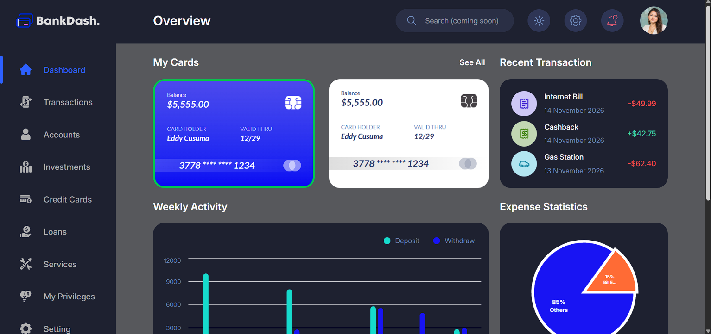
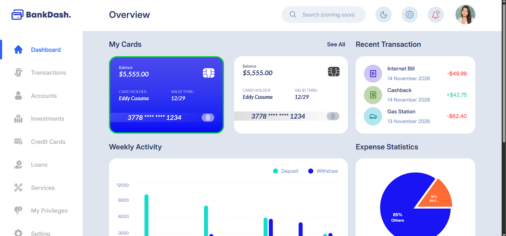
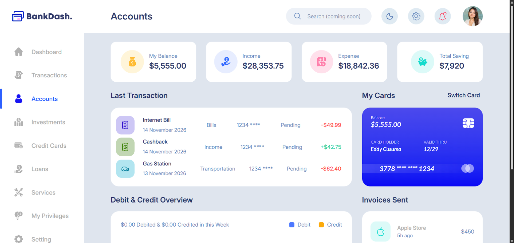
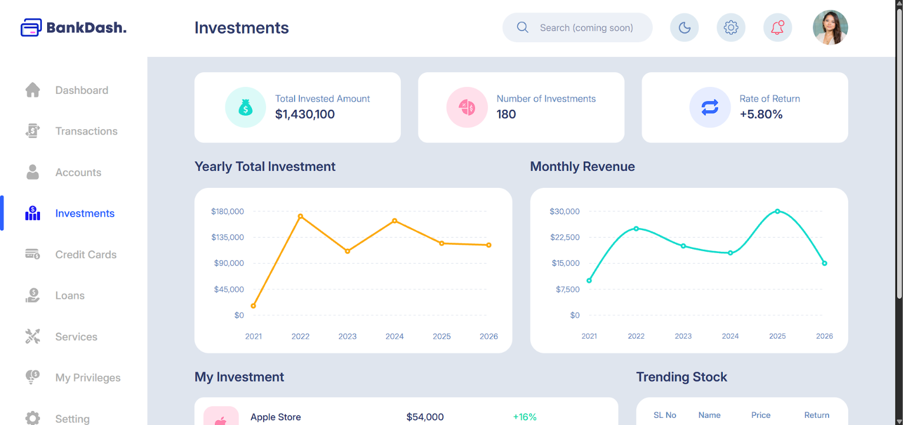

# BankDash — Bank Dashboard

A responsive online-banking dashboard built with React and TypeScript: cards, quick transfers, transaction history, accounts, investments, and user settings. This is a frontend demo: there is no backend, and all data is stored in the browser.

**Demo:** https://bank-dashboard-beta-rust.vercel.app/






## Features

- **Dashboard:** two bank cards (switch the active one), recent transactions, weekly activity, expense statistics, balance history.
- **Quick transfer:** pick a contact, enter an amount, send. Input is validated (amount greater than zero, at most 2 decimal places, sufficient funds) and the result is shown in a popup notification.
- **Transactions:** All / Income / Expense filters, a paginated table (a card list on mobile), and a monthly expenses chart.
- **Accounts and investments:** balance, income and expense totals, debit and credit overview, investment charts.
- **Settings:** profile with avatar upload (cropped and compressed in the browser), preferences, a two-factor authentication toggle, password change.
- **Dark theme** (remembered between visits) and a layout adapted down to 320 px.
- **Demo data:** the "+ generate data" button on the Transactions page fills both cards with sample transactions and investments.

## Tech Stack

React 19 · TypeScript · Vite · Tailwind CSS 4 · React Router 7 · Zustand (with `persist`) · Recharts · Lucide icons · Vitest + Testing Library

## Getting Started

```bash
npm install
npm run dev       # http://localhost:5173
npm run build     # production build into dist/
npm run preview   # preview the production build locally
npm test          # run the tests once (npm run test:watch for watch mode)
```

Requires Node 20+.

## Project Structure

```
src/
├── components/   # app shell and shared UI: Nav, Header, Card, NotifyDropdown
├── config/       # static data: navigation (routes.ts), contacts, transaction icons
├── features/     # feature modules: charts, settings forms, transfers, transactions
├── hooks/        # usePagination, useMakeTransfer, usePopup, useTheme, ...
├── pages/        # route components, one per page (+ NotFoundPage)
├── store/        # Zustand store persisted to localStorage
├── types/        # shared TypeScript types
└── utils/        # money helpers, avatar processing, demo-data generators
```

## Key Design Decisions

- **Navigation from a single list.** `config/routes.ts` drives the sidebar, the burger menu, and the page title. The active item is matched case-insensitively, so `/Transactions` and `/transactions` behave the same. Unknown URLs render a 404 page inside the common app shell.
- **Money rules.** The sign of a transaction amount is the single source of truth: income is positive, expense is negative. A transfer is stored as a negative amount with a `recipientId` field, and the card balance is reduced by that amount. After every operation amounts are rounded to two decimals (`round2`) so floating-point error does not accumulate, and all output goes through `formatMoney` / `formatSigned`.
- **Validation as a pure function.** `validateTransfer` returns a result object instead of throwing: the hook stays simpler and the rules are easy to test.
- **Safe persistence.** The store is saved to `localStorage` through a wrapper that does not crash when storage is full, and the password is intentionally excluded from persisted data. The avatar is cropped to 256×256 and compressed to JPEG before saving (typically 5–20 KB); files larger than 5 MB are rejected.
- **No theme flash.** A small script in `index.html` applies the saved theme before the first paint.
- **SPA hosting.** `vercel.json` rewrites all paths to `index.html`, so refreshing the page or opening a direct link such as `/transactions` works on Vercel.

## Known Limitations

This is a portfolio demo, not a production banking application.

**Data and security**
- There is no backend. Everything is stored in the browser's `localStorage`; the profile, password change, and two-factor toggle work at the UI level only.
- The "current password" check can only compare against a password entered in the current session (the password is intentionally not persisted), so after a page reload the check is skipped.
- Money is stored as JavaScript numbers rounded to two decimals, not as integer cents. That is sufficient at this scale; a real system would use integer minor units on the server.

**Functionality**
- Credit Cards, Loans, Services, and My Privileges are "Coming soon" placeholders. The "See All", "+ Add Card", and "Download" (receipt) buttons and the search field are disabled.
- Currency, time zone, and notification settings are saved but have no effect on the UI (USD only).
- Total Saving, Invoices, My Investment, Trending Stock, and Monthly Revenue use static sample data.
- "+ generate data" appends sample transactions to the history without changing the card balance, and every click adds a new set.
- The transfer recipient is stored (`recipientId`) but is not yet displayed in the UI, and the selected contact stays highlighted after sending.

**Charts**
- Weekly Activity groups demo data by day of the week rather than by the current week; Expense Statistics counts income under "Others"; Balance History shows monthly turnover, not the balance. They illustrate the interface and are not real analytics.

**Tooling**
- The ESLint configuration currently covers JavaScript files only, so TypeScript files are checked by `tsc` (at build time) but not by ESLint.

## Possible Next Steps

A backend API with real authentication; a money model in integer cents and a balance computed from transactions; code splitting with `React.lazy`, WOFF2 fonts, and optimized avatars; `typescript-eslint`; forms with react-hook-form and zod; full ARIA markup for tabs and accessible charts.