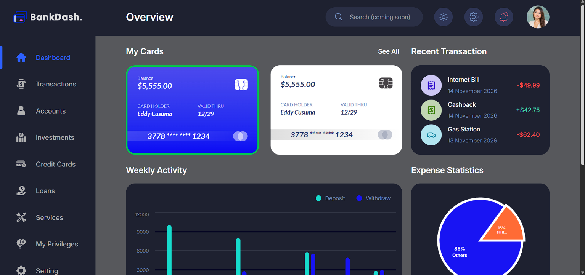
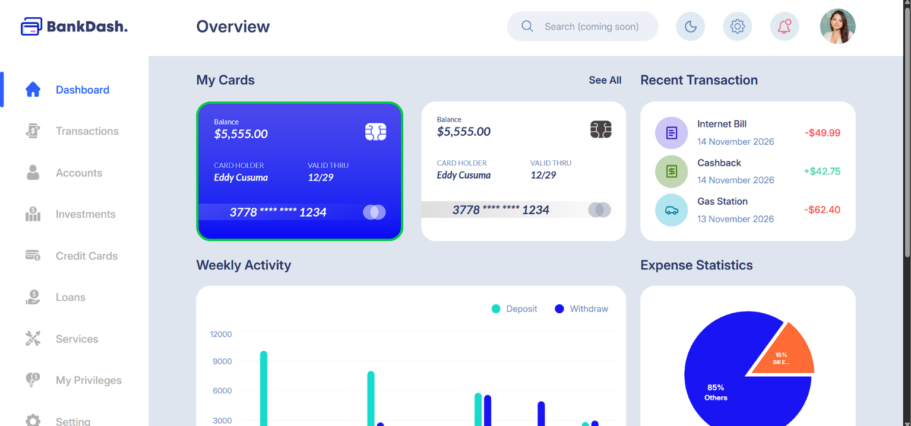
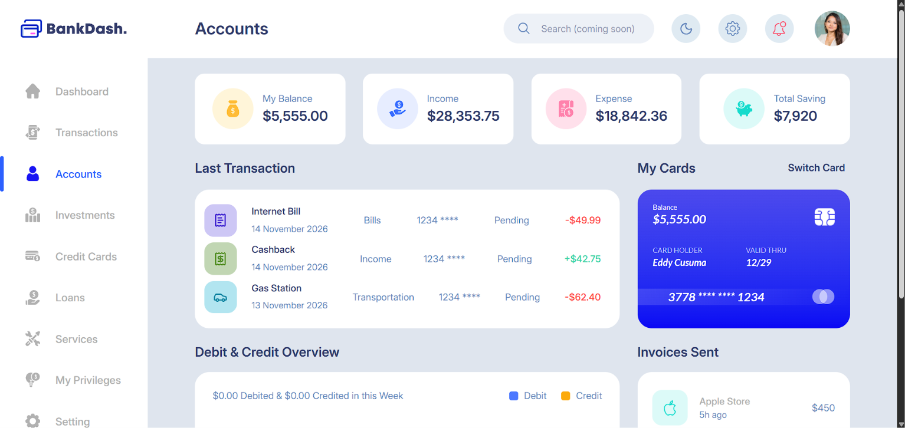
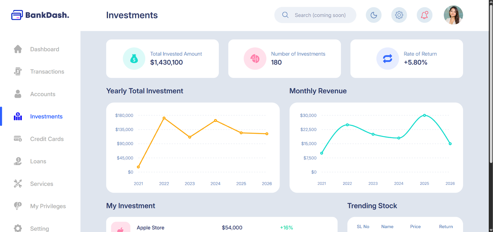

# BankDash — Bank Dashboard

Адаптивная панель интернет-банка на React и TypeScript: карты, быстрые переводы, история транзакций, счета, инвестиции и настройки пользователя. Это фронтенд-демо: бэкенда нет, все данные хранятся в браузере.

**Демо:** https://bank-dashboard-beta-rust.vercel.app/






## Возможности

- **Dashboard:** две банковские карты (переключение активной), последние транзакции, недельная активность, статистика расходов, история баланса.
- **Быстрый перевод:** выбор контакта, ввод суммы, отправка. Ввод проверяется (сумма больше нуля, не более 2 знаков после точки, достаточно средств), результат показывается во всплывающем уведомлении.
- **Транзакции:** фильтры All / Income / Expense, таблица с пагинацией (на мобильных список карточек), график расходов по месяцам.
- **Счета и инвестиции:** баланс, суммы доходов и расходов, обзор дебета и кредита, графики инвестиций.
- **Настройки:** профиль с загрузкой аватара (обрезка и сжатие в браузере), предпочтения, переключатель двухфакторной аутентификации, смена пароля.
- **Тёмная тема** (запоминается между визитами) и адаптированная верстка.
- **Демо-данные:** кнопка «+ generate data» на странице Transactions заполняет обе карты примерами транзакций и инвестиций.

## Технологии

React 19 · TypeScript · Vite · Tailwind CSS 4 · React Router 7 · Zustand (с `persist`) · Recharts · Lucide icons · Vitest + Testing Library

## Запуск

```bash
npm install
npm run dev       # http://localhost:5173
npm run build     # production-сборка в dist/
npm run preview   # локальный просмотр production-сборки
npm test          # однократный запуск тестов (npm run test:watch — режим наблюдения)
```

Требуется Node 20+.

## Структура проекта

```
src/
├── components/   # каркас и общий UI: Nav, Header, Card, NotifyDropdown
├── config/       # статические данные: навигация (routes.ts), контакты, иконки транзакций
├── features/     # функциональные модули: графики, формы настроек, переводы, транзакции
├── hooks/        # usePagination, useMakeTransfer, usePopup, useTheme, ...
├── pages/        # компоненты маршрутов, по одному на страницу (+ NotFoundPage)
├── store/        # стор на Zustand с сохранением в localStorage
├── types/        # общие типы TypeScript
└── utils/        # работа с деньгами, обработка аватара, генераторы демо-данных
```

## Ключевые решения

- **Навигация из одного списка.** `config/routes.ts` питает боковое меню, бургер-меню и заголовок страницы. Активный пункт определяется без учёта регистра, поэтому `/Transactions` и `/transactions` работают одинаково. Неизвестные адреса показывают страницу 404 внутри общего каркаса приложения.
- **Правила работы с деньгами.** Знак суммы транзакции — единственный источник правды: доход положительный, расход отрицательный. Перевод сохраняется как отрицательная сумма с полем `recipientId`, а баланс карты уменьшается на эту сумму. После каждой операции суммы округляются до двух знаков (`round2`), чтобы не копилась погрешность чисел с плавающей точкой, а весь вывод идёт через `formatMoney` / `formatSigned`.
- **Валидация как чистая функция.** `validateTransfer` возвращает объект результата, а не бросает исключения: хук получается проще, а правила легко тестировать.
- **Безопасное сохранение.** Стор сохраняется в `localStorage` через обёртку, которая не падает при переполнении хранилища, а пароль намеренно не попадает в сохраняемые данные. Аватар обрезается до 256×256 и сжимается в JPEG перед сохранением (обычно 5–20 КБ), файлы больше 5 МБ отклоняются.
- **Тема без «вспышки».** Небольшой скрипт в `index.html` применяет сохранённую тему до первой отрисовки страницы.
- **Хостинг SPA.** `vercel.json` перенаправляет все пути на `index.html`, поэтому обновление страницы или переход по прямой ссылке вроде `/transactions` работает на Vercel.

## Известные ограничения

Это демо для портфолио, а не готовое банковское приложение.

**Данные и безопасность**
- Бэкенда нет. Всё хранится в `localStorage` браузера; профиль, смена пароля и переключатель двухфакторной аутентификации работают только на уровне интерфейса.
- Проверка «текущего пароля» может сравнивать только с паролем, введённым в текущей сессии (пароль намеренно не сохраняется), поэтому после перезагрузки страницы она пропускается.
- Деньги хранятся как числа JavaScript, округлённые до двух знаков, а не как целые центы. Для этого масштаба достаточно; в настоящей системе используются целые минимальные единицы на сервере.

**Функциональность**
- Credit Cards, Loans, Services и My Privileges — заглушки «Coming soon». Кнопки «See All», «+ Add Card», «Download» (чек) и поле поиска отключены.
- Валюта, часовой пояс и настройки уведомлений сохраняются, но на интерфейс не влияют (только USD).
- Total Saving, Invoices, My Investment, Trending Stock и Monthly Revenue используют статические примеры данных.
- «+ generate data» дописывает примеры транзакций в историю, не меняя баланс карты, и каждый клик добавляет новый набор.
- Получатель перевода сохраняется (`recipientId`), но пока не показывается в интерфейсе, а выбранный контакт остаётся подсвеченным после отправки.

**Графики**
- Weekly Activity группирует демо-данные по дням недели, а не по текущей неделе; Expense Statistics относит доходы к «Others»; Balance History показывает месячный оборот, а не баланс. Они иллюстрируют интерфейс и не являются настоящей аналитикой.

**Инструменты**
- Конфигурация ESLint сейчас покрывает только JavaScript-файлы, поэтому TypeScript-файлы проверяются через `tsc` (при сборке), но не ESLint.

## Возможные следующие шаги

API бэкенда с настоящей авторизацией; модель денег в целых центах и баланс, вычисляемый из транзакций; `typescript-eslint`; работа с формами через react-hook-form и zod; полноценная разметка ARIA для вкладок и доступные графики.